# OCI Limit Workbench — User Guide

**Applies to:** OCI Limit Workbench v0.7.1  
**Prepared:** 30 October 2026  
**Audience:** Operators preparing, reviewing, sharing, and submitting OCI service-limit increase requests.

This guide follows the workflow from a bill of materials (BOM) to a reviewed request. You can create and share drafts offline, then connect to OCI when you need current limits, questionnaires, validation, or submission.

> **About the screenshots:** All images are actual captures of the app running with synthetic demo data. Tenancy names, regions, ADs, limits, questionnaire responses, submission results, and saved-draft counts in these images are illustrative. No live OCI requests were submitted to produce this guide. The compute examples deliberately demonstrate changing a draft mapping; they are not recommendations for mapping the displayed SKU to a compute limit. Your catalogs and OCI responses determine the correct mapping.

## Contents

1. [Overview and key concepts](#1-overview-and-key-concepts)
2. [Installation and startup](#2-installation-and-startup)
3. [Workspace tour](#3-workspace-tour)
4. [Create a draft from a BOM](#4-create-a-draft-from-a-bom)
5. [Review request items](#5-review-request-items)
6. [Save, reopen, and share drafts](#6-save-reopen-and-share-drafts)
7. [Connect to OCI and retrieve limits](#7-connect-to-oci-and-retrieve-limits)
8. [Prepare questionnaires and validate](#8-prepare-questionnaires-and-validate)
9. [Export or submit a request](#9-export-or-submit-a-request)
10. [Track submissions and refresh status](#10-track-submissions-and-refresh-status)
11. [Maintain catalogs](#11-maintain-catalogs)
12. [Troubleshooting, storage, and limitations](#12-troubleshooting-storage-and-limitations)

## 1. Overview and key concepts

OCI Limit Workbench runs on your computer and opens in a browser. It stores drafts as local JSON files; it does not require a database.

| Concept | Meaning in the app |
| --- | --- |
| BOM | The CSV or Excel file listing products, quantities, and units. The original uploaded file is preserved in the draft. |
| SKU catalog | The app's saved reference file mapping commercial product SKUs to OCI services and limits. |
| Offline service catalog | A pair of files containing OCI services and limit definitions for offline mapping selection. It does not contain current allowed limits or usage. |
| Draft | A portable working document containing request items, original BOM data, mapping snapshots, and saved preparation/history information. |
| Requested total | The desired final limit, **not the amount to add** to the current limit. |
| Availability domain (AD) | A scope for certain limits. The app records a separate requested total for each applicable AD. |
| Validation | A technical check of the draft against current OCI information. It does not constitute OCI approval. |
| Submission record | A locally recorded attempt to submit through the app, with its outcome and request OCID when returned. |

For example, if OCI currently allows 100 and you want the limit to become 300, enter **300** as the requested total. Do not enter 200 as an increment.

| Task | Requires an OCI connection? |
| --- | --- |
| Import a BOM, edit totals, save/export/import draft JSON, inspect the original BOM | No |
| Select mappings from installed offline definitions; maintain the SKU catalog using offline definitions | No |
| Import an offline catalog pair supplied by another operator | No |
| Read current allowed limits, usage, and actual AD names | Yes |
| Generate offline definitions from OCI or select live mappings | Yes |
| Retrieve questionnaires, validate, and generate a validated CLI bundle | Yes |
| Submit through the app or refresh a recorded request's status | Yes |

The usual sequence is **import BOM → review mappings and totals → save → connect and refresh → prepare questionnaires → validate → save → export or submit → track status**. You can stop after saving/exporting a draft and hand it to another operator.

## 2. Installation and startup

### Prerequisites

Use the Python-based application release in a writable local folder. You need an approved **Python 3.10 or later** installation with pip and virtual-environment support, plus a browser. Dependency compatibility still depends on the selected Python version, operating system, and CPU.

The release includes the prebuilt browser UI. Operators do not need Node.js, Docker, or Git. OCI CLI is needed only on the machine that will execute an exported CLI submission script.

Installation normally needs internet access or an approved Python package mirror. Once installed, offline draft work needs neither network access nor OCI credentials.

The project records operator-reported installation and startup success with Python 3.14 on macOS 26.7 Apple Silicon, Windows Server 2019 Standard, and Windows 11 Pro. Linux remains unverified. These reports do not imply exhaustive workflow testing on every platform. Use the Python-based release; the experimental bundled macOS builds are not the selected operator distribution.

### Install and launch

1. Extract the entire release archive into a local writable folder.
2. Open a terminal in that folder.
3. Run the setup and startup commands for your platform.

**macOS / Linux**

~~~sh
sh setup.sh
sh start.sh
~~~

**Windows Command Prompt**

~~~bat
setup.cmd
start.cmd
~~~

**Windows PowerShell**, where permitted:

~~~powershell
.\setup.ps1
.\start.ps1
~~~

Setup creates a machine-local **.venv** and installs/checks dependencies. It does not supply operational catalogs or replace your drafts.

**Expected result:** The app opens at [http://127.0.0.1:8765](http://127.0.0.1:8765). Keep the terminal open while using the app. Press **Ctrl+C** in that terminal to stop it. The browser and server must run on the same machine.

### Supply the catalog files

Catalogs are supplied separately from the release. Place these files in the application folder beside the launch scripts:

| File | Needed for |
| --- | --- |
| **oci_sku_limit_catalog.json** | Creating new drafts from a BOM using the saved SKU mappings. |
| **oci_services.json** | Offline service selection; used together with the definitions file. |
| **oci_limit_definitions.json** | Offline limit selection, definition metadata, and AD scope information. |

Alternatively, initialize the offline service/definition pair through **Offline service catalog**, as described in [section 11](#11-maintain-catalogs).

Without the SKU catalog, the app still starts and can import existing draft JSON, but new BOM-based draft creation reports the missing file.

### Optional startup settings

Choose a different port or draft folder by passing arguments to the launcher:

~~~sh
sh start.sh --port 8767 --data-dir "/path/to/OCI drafts"
~~~

~~~bat
start.cmd --port 8767 --data-dir "C:\Work\OCI drafts"
~~~

Open the address using the selected port. The **--no-browser** option suppresses automatic browser opening. The **--data-dir** setting changes draft/submission storage, not the app's SKU catalog location.

## 3. Workspace tour

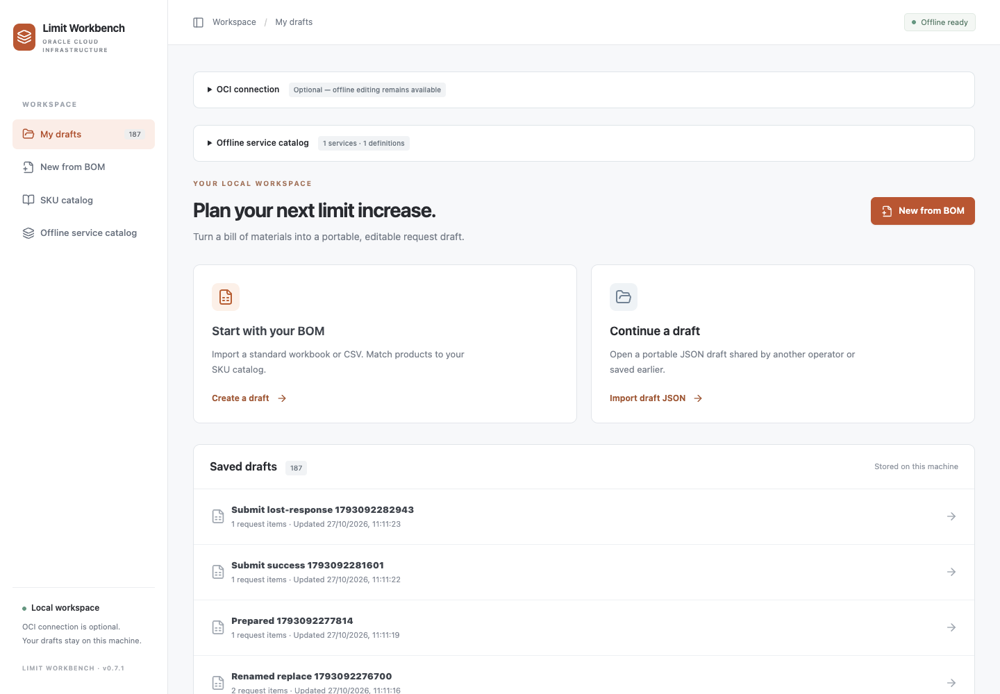

*Figure 1. My drafts is the starting point. The demo library may already contain synthetic test drafts.*

| Area | What you do there |
| --- | --- |
| **My drafts** | Open saved local drafts or import a portable JSON draft. |
| **New from BOM** | Download the CSV template and create a draft from a CSV/XLSX file. |
| **SKU catalog** | Add SKUs and maintain the app's shared mapping catalog. |
| **Offline service catalog** | Import or generate the service/definition pair used for offline selection. |
| **OCI connection** | Load profiles, connect, select the live-data region, or disconnect. |
| **Current draft** | Return to the draft currently open in this tab. |

Inside a draft, use these tabs:

- **Request items:** Review mappings, requested totals, units, and live readings.
- **Prepare & export:** Retrieve questionnaires, validate, export a CLI bundle, submit, and inspect recorded attempts.
- **Original BOM:** Inspect source rows and download the exact original upload.
- **History:** Inspect recorded validation and submission information.

## 4. Create a draft from a BOM

### Prepare the input file

1. Click **New from BOM**.
2. Select **Download the standard CSV template** if you need a starting file.
3. Use a UTF-8 comma-separated CSV, or an XLSX workbook with a **BOM** data sheet and headers in row 1.
4. Include the four required columns exactly as shown below.

~~~csv
SKU,Scenario/Product Description,Qty,Metric
B91961,Block storage capacity,200,GB
UNKNOWN,Product needing mapping,5,Each
~~~

This is the synthetic example used in the screenshots. Replace its rows with your actual BOM.

| Column | Content |
| --- | --- |
| **SKU** | Product identifier to look up in the app's saved SKU catalog. |
| **Scenario/Product Description** | Product or workload description. |
| **Qty** | Source quantity for review. |
| **Metric** | Source unit or commercial metric. |

Keep one product per row. Additional named columns are preserved. Duplicate product rows stay separate; their quantities are not automatically summed. Rows without a SKU remain in the source data but do not create request items. At least one row must have a SKU.

For XLSX uploads, consolidate other data sheets before import. Formula quantities need a numeric result already saved by Excel; the app does not calculate workbook formulas.

### Import and create

1. Select your file under **BOM file**.
2. Review the displayed app-provided SKU catalog. New imports use its **last saved version**, including when the catalog editor has unsaved changes.
3. Click **Create draft**.
4. Enter a meaningful **Draft name** and **Business justification**.

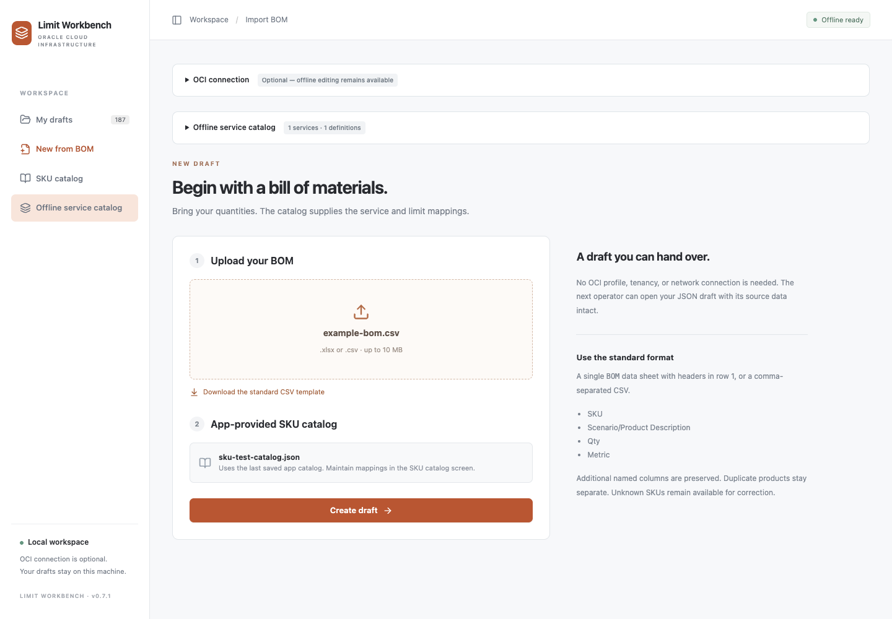

*Figure 2. New from BOM uses the saved app catalog automatically; no catalog upload is required.*

**Expected result:** The draft opens with request items and its original BOM attached. Known mappings are copied from the saved catalog. Unknown SKUs stay in the draft for correction.

Do not assume every BOM quantity becomes a ready-to-submit total. The app only initializes quantities for its explicit block-storage capacity interpretation; other quantities and all mappings require operator review.

## 5. Review request items

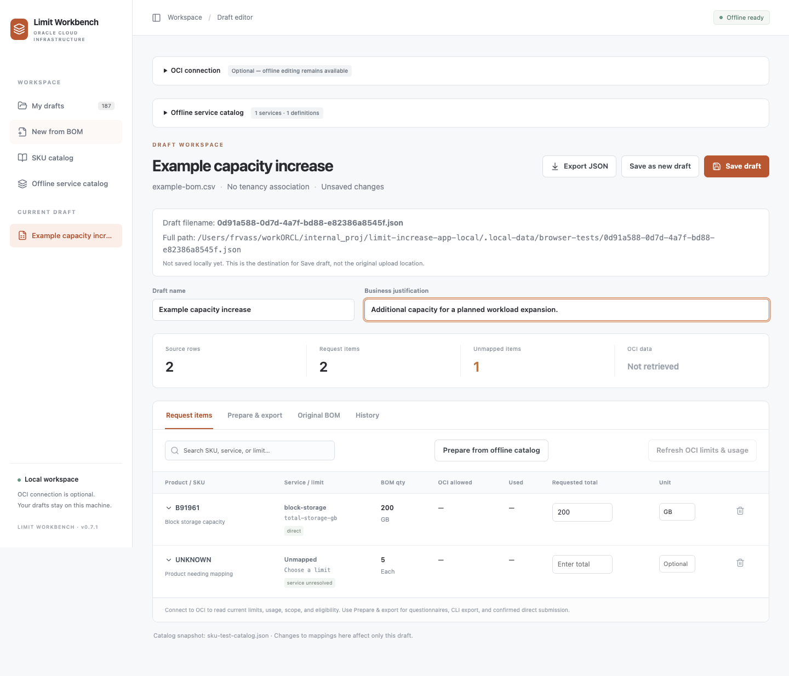

*Figure 3. Review the mapping and desired final total for every item. An unmapped SKU remains visible.*

1. Open **Request items** and search for the SKU, service, or limit you need.
2. Expand a SKU row to inspect its mapping details.
3. Check that the service and limit match the resource you intend to increase.
4. Set the **Requested total** to the desired final limit. Leave incomplete values blank while drafting.
5. Review **Unit** against the selected OCI limit. Unit text is optional review metadata; the app does not convert quantities or check unit compatibility, and does not send this text in the OCI request payload.
6. After changing a mapping, review its quantities and units and check **I have checked the requested quantities and units for this mapping.** This acknowledgment is required for request validation/export after remapping.
7. Click **Save draft** to preserve your edits.

### Correct an unresolved or unsuitable mapping

For an offline selection, expand the row, choose **Offline OCI catalog** as the mapping source, select the service and limit, inspect the definition, and click **Use offline mapping in draft**. This requires an initialized offline catalog pair.

With an OCI connection, select a service and limit in the live picker, inspect the definition, and click **Use this mapping in draft**. **Reload OCI definitions** refreshes mapping metadata when needed.

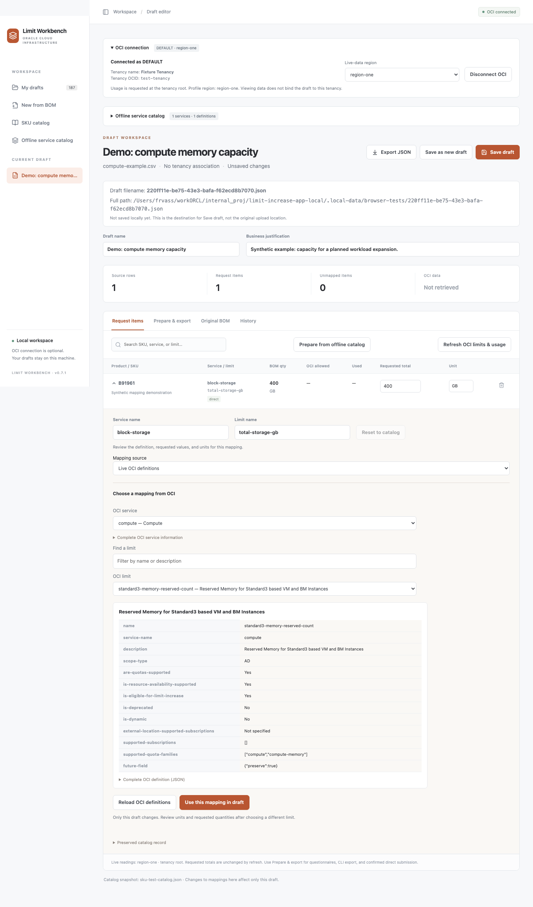

*Figure 4. The live picker exposes definition metadata before applying a draft-only mapping. The synthetic SKU remapping shown here demonstrates the controls only.*

Manual service/limit edits are also available in the expanded row, but they require review. A selected or directly mapped limit is not automatically eligible for an increase. Inspect eligibility and deprecation metadata; quota support is a different property.

Draft mapping changes affect only that draft. They do not update the saved SKU catalog or other drafts.

### Work with availability-domain limits

Known AD-scoped definitions can create offline placeholder rows **1, 2, and 3**, each with its own requested total. These numbers are logical positions, not discovered AD names. The app does not copy a BOM total into every AD.

**Prepare from offline catalog** attaches available definition metadata and initial AD rows to an existing draft. It does not restore rows already reconciled against actual OCI ADs.

After a successful live refresh, actual AD discovery can remove unmatched placeholder rows, including values entered in them. Matching positions retain their totals, and newly discovered positions start empty. Review the reported removal count before saving. Failed or empty discovery does not delete rows.

Use the remove action only when the item should not be requested. Removing a request item preserves its original BOM row.

## 6. Save, reopen, and share drafts

| Action | Result |
| --- | --- |
| **Save draft** | Writes the current draft to the configured local draft folder and adds/updates it in My drafts. |
| **Save as new draft** | Saves a separate draft with a new ID and filename. Existing history is retained, but current validation must be renewed for the copy. |
| **Export JSON** | Downloads a portable draft through the browser. It does not save the working draft into the local library. |
| **Import draft JSON** | Opens a portable draft. Save it to add it to this machine's library. |

The draft workspace displays the local JSON filename and full path. The filename follows the draft ID, not its editable name. Before the first save, the displayed path is the intended destination.

### Continue on this machine

1. Click **Save draft** and wait for the saved confirmation.
2. Return to **My drafts**.
3. Select the saved draft to reopen it.

Draft content is saved on explicit action. Save before closing the tab or stopping the server.

### Hand a draft to another operator

1. Click **Export JSON**.
2. Share the downloaded JSON using your normal approved channel.
3. The recipient opens the app and selects **Import draft JSON** in **My drafts**.
4. The recipient reviews the draft and clicks **Save draft**.

The recipient can inspect and edit offline without your original BOM, catalog, or OCI credentials. The portable JSON includes the original BOM attachment and catalog/mapping snapshots, plus recorded answers, validation, and submission history where present. Handle it as a document containing the BOM and request details.

### Resolve a save conflict

If another version of the same draft is already saved, the app preserves your open edits and offers:

- **Save as new draft** to keep both versions.
- **Replace saved draft** to replace the reviewed saved version after confirmation.

Renaming the draft does not change its identity or eliminate a conflict. Do not discard the open version before saving/exporting edits you need.

### Inspect or recover the original BOM

Open **Original BOM** to inspect the unchanged source rows. Select **Original file** to download the exact uploaded file. Edits to request items do not rewrite the source BOM.

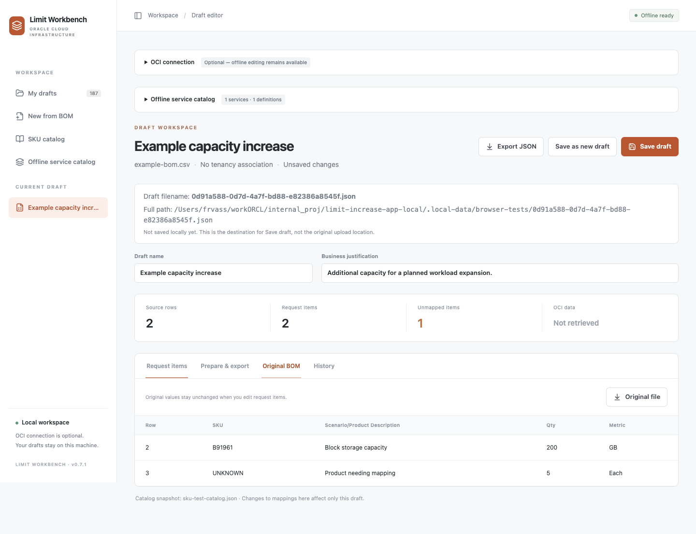

*Figure 5. Original BOM preserves source data independently of the edited request items.*

## 7. Connect to OCI and retrieve limits

Connected work uses your local OCI **API-key configuration/profile**. Obtain the appropriate profile and permissions through your normal OCI administration process. Security-token profiles are not supported in this version.

1. Expand **OCI connection**.
2. Enter the **OCI config file path** on the machine running the app. The default is **~/.oci/config**.
3. Click **Load profiles**.
4. Select the intended **OCI profile**, including DEFAULT or a named profile.
5. Click **Connect to OCI**.
6. Verify the tenancy name and OCID, then select the **Live-data region**.

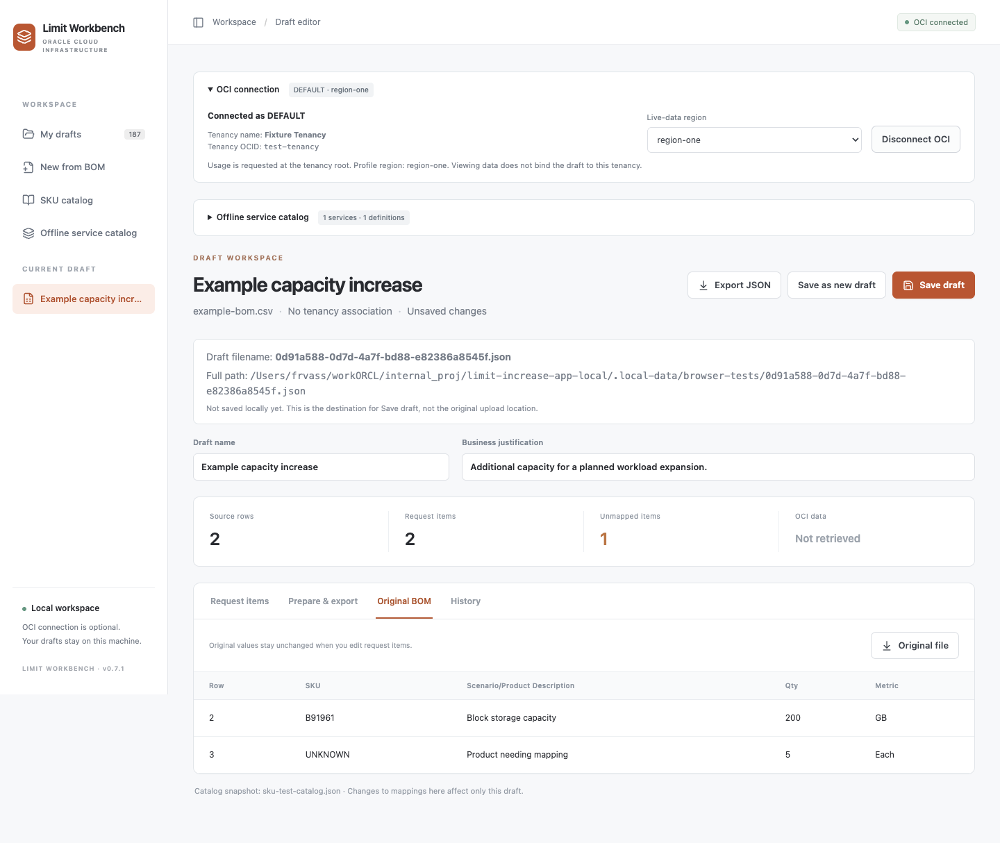

*Figure 6. The connection panel identifies the target tenancy and selected region. All connection values here are synthetic.*

**Expected result:** The panel displays the connected profile and tenancy context. If tenancy-name lookup is denied, a warning can appear while the tenancy OCID remains available. The OCID identifies the tenancy; the name is informational.

Connecting reads OCI information but does not submit a limit-increase request. Credentials remain in the backend; they are not added to the portable draft.

### Retrieve current values

1. Open the draft's **Request items** tab.
2. Resolve/review mappings before relying on comparisons.
3. Click **Refresh OCI limits & usage** and wait for the job to finish.
4. Review **OCI allowed**, **Used**, AD rows, timestamps, and per-item warnings. Expand an item for further returned metadata.
5. Review quantities after AD reconciliation, then save the draft.

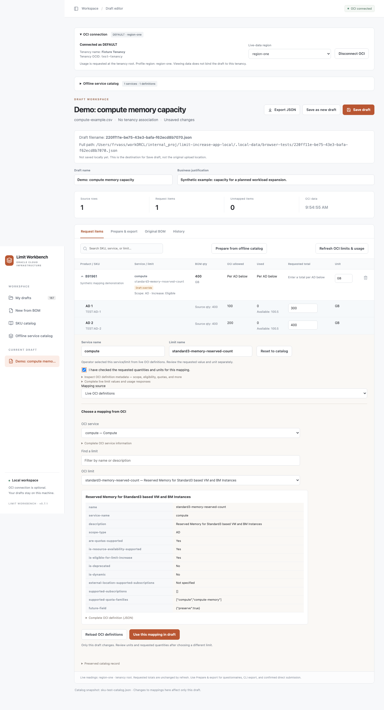

*Figure 7. AD-scoped requests use separate desired totals. Missing or denied readings must not be interpreted as zero.*

Reads use the tenancy root. A denied or unsupported usage lookup does not imply zero usage. Per-item errors can coexist with successful readings for other items.

Disconnecting or changing region clears displayed readings. After reloading the browser or restarting the server, reconnect and refresh to restore them. Ordinary live readings and connection context are session information; successful validation records retain target-specific evidence separately.

> **Region matters:** The live-data selector supports enrichment and validated CLI export for its selected region. **Direct in-app submission requires the profile's region.** Select that region and prepare/validate again before submitting through the app.

## 8. Prepare questionnaires and validate

Start with the intended tenancy/region, reviewed mappings, and current allowed values. Each requested total must be a **positive integer greater than its current allowed value**, expressed in the selected limit's unit.

1. Enter the draft name and business justification.
2. Confirm quantities/units for any changed mapping in its expanded **Request items** row.
3. Open **Prepare & export**.
4. Verify the displayed target tenancy and region.
5. Click **Prepare questionnaires**. The app retrieves current definitions, ADs, allowed values, and question definitions.
6. Complete the returned questions separately for each target/AD. Supported controls include text, numbers, single-choice selections, and checkboxes.
7. Click **Validate request**.
8. Resolve every reported blocker, prepare again if definitions/questions changed, and validate again.
9. When **Technical checks passed** appears, review the exact API payload and save the draft.

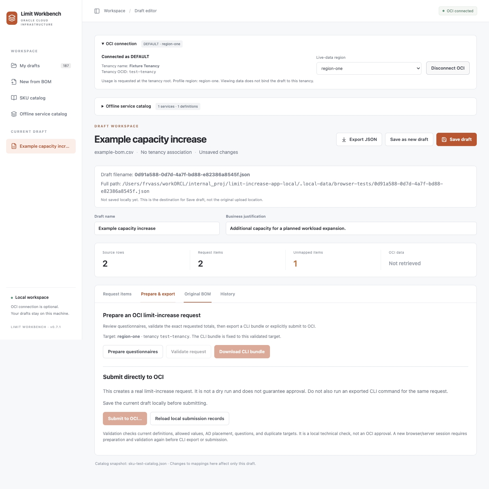

*Figure 8. Preparation, validation, CLI export, and direct submission are explicit actions.*

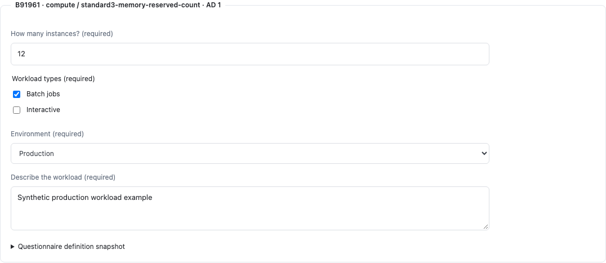

*Figure 9. Example questionnaire for one AD. Actual fields come from OCI and may differ or be absent.*

Targets with no questionnaire fields are omitted from the question forms, but remain in the request and still undergo validation. Failed question discovery is an error, not an empty questionnaire.

Common blockers include unresolved/review-required mappings, unchecked mapping-review confirmation, missing or invalid totals, totals that do not exceed current allowed values, ineligible limits, unanswered required questions, and duplicate service/limit/region/AD targets. The app does not merge duplicate totals or silently drop blocked items.

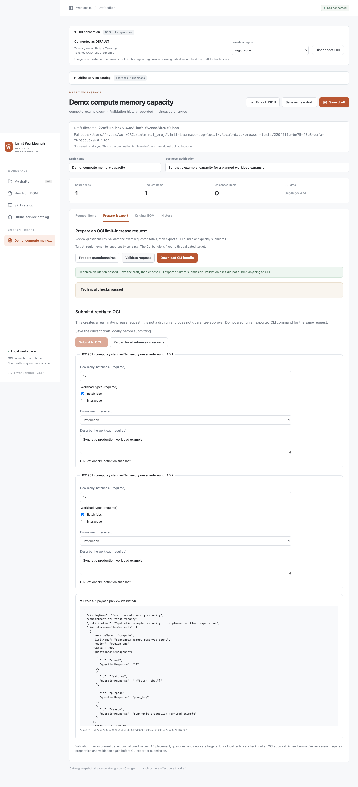

*Figure 10. Technical checks passed means the payload passed local checks against current OCI data; it does not mean OCI approved the increase.*

Changes to the draft, answers, or target invalidate the current export/submission authorization. Preparation/validation receipts expire after 30 minutes and are lost when the server restarts or the connection is renewed. Historical records in saved drafts do not authorize a new submission; prepare and validate again when required.

You can save incomplete drafts and export draft JSON even while request validation is blocked. Previously saved questionnaire answers remain editable offline.

## 9. Export or submit a request

After successful validation, choose the execution route for this request. **Do not submit the same request through both the app and an exported CLI script.**

### Option A: Download an OCI CLI bundle

1. Review the validated target, requested totals, and exact payload.
2. Save the draft to retain the answers and validation record.
3. Click **Download CLI bundle**.
4. Extract the downloaded ZIP and read its **README.txt**.
5. On a machine with OCI CLI installed and an appropriate OCI profile, execute the supplied script with the validated region and intended profile/config.

**Downloading the bundle does not submit a request. Running its submission script creates the OCI request.**

| Bundle file | Purpose |
| --- | --- |
| **request-api.json** | Exact validated API payload displayed by the app. |
| **request.json** | Input for the OCI CLI's --from-json option. |
| **items.json** | Request items for the CLI's --items option. |
| **validation.json** | Target, timestamp, hashes, and validation snapshots. |
| **submit.sh** | Shell submission script. |
| **submit.ps1** | PowerShell submission script. |
| **README.txt** | Bundle-specific instructions and validation scope. |

Shell example, run from the extracted bundle directory:

~~~sh
sh submit.sh '<validated-region>' '<profile>' '/absolute/path/to/config'
~~~

PowerShell example:

~~~powershell
.\submit.ps1 -OciRegion '<validated-region>' -OciProfile '<profile>' -OciConfigFile 'C:\path\to\config'
~~~

Replace the placeholders with the actual validated region and credential settings. The scripts refuse a different region; AD names and items belong to the validated target. The profile/config must authorize that tenancy.

Do not edit the payload after validation and treat it as still validated. Make changes in the app and validate again. CLI execution is not recorded or reconciled by the app in this version; retain its output and avoid rerunning it blindly.

### Option B: Submit directly through the app

1. Ensure the selected region matches the connected **profile region**. If necessary, change it and prepare/validate again.
2. Click **Save draft** after the current inputs and validation record are ready.
3. Click **Submit to OCI…**.
4. Review the profile, tenancy OCID, region, service/limit targets, actual AD names, requested totals, and exact payload in the confirmation panel.
5. Check the acknowledgment confirming the target/totals and that this request has not already been submitted through CLI or another machine.
6. Click **Confirm and submit to OCI** once.
7. Keep the app running while it rechecks OCI information and records the result.

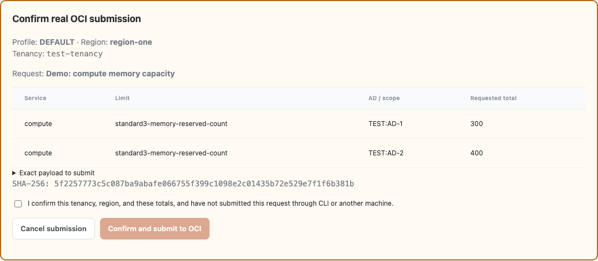

*Figure 11. Opening confirmation does not submit. In normal operation, the final confirmation button creates a real OCI request.*

**Expected result:** A recorded attempt appears with its local outcome and, when returned, the request OCID and OCI status at submission. This records request creation, not approval of the requested increase. Save/export the draft for handover and retain the submission journal.

If a result-storage warning offers **Download submission record**, download it immediately as a recovery copy.

## 10. Track submissions and refresh status

Find **Recorded submission attempts** in **Prepare & export**.

| Displayed local outcome | What to do |
| --- | --- |
| **Submitted to OCI** | Retain the OCID. Refresh status explicitly when needed; submission does not mean approval. |
| **Rejected by OCI** | Read the error, correct the issue, validate again, save, and explicitly confirm a new attempt. |
| **Outcome unknown** | Investigate the existing attempt in OCI. Further submission is blocked to avoid duplication. |
| **In progress / outcome not yet recorded** | Keep the app running if it is still processing. After an interruption, reload local records and investigate before taking further action. |

### Read the latest request status

1. Connect to the tenancy recorded for the request, using a profile with permission to read it.
2. Locate the locally recorded request with an OCID.
3. Click **Refresh status from OCI** beside that request.
4. Review **Latest OCI status** and **Last checked**.

The app queries the request's **recorded region**, regardless of the current live-data region selector. It preserves **OCI status at submission** and original submission facts. There is no automatic status polling.

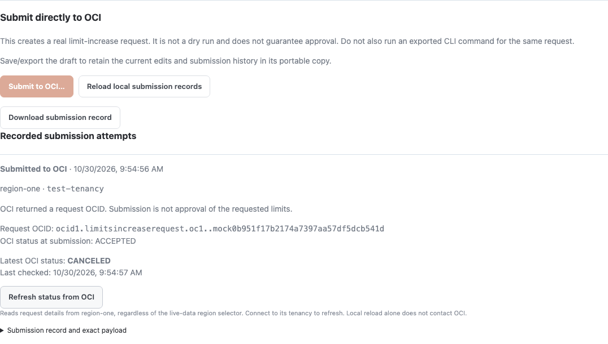

*Figure 12. The demo returns CANCELED on refresh to illustrate that the latest status can differ from the submission-time status. It does not represent a live OCI result.*

**Reload local submission records** reads disk only. Use it after a lost browser response; it does not query OCI or resolve an unknown outcome by itself.

If refresh fails, the previous known status remains visible and may be stale. Resolve the connection/permission problem before relying on it.

### Preserve duplicate protection

Submission attempts are journaled in the draft folder's **submissions/** subfolder. Back it up with your drafts. The app merges local journal records into reopened, saved, and exported drafts.

Do not delete the journal, rename/copy a draft, or execute an exported CLI script to bypass an uncertain or duplicate attempt. Protection is local to the configured data folder; it cannot detect every submission from another machine or external CLI.

Attaching CLI-created requests and reconciling unknown attempts without a confirmed OCID are not implemented. Imported-only history does not provide the same locally authoritative status-refresh capability. A canceled request does not automatically remove duplicate guards or trigger resubmission.

## 11. Maintain catalogs

### Maintain the SKU mapping catalog

Use **SKU catalog** when a correction should be available to future BOM imports. Use the draft editor when the correction belongs only to the current draft.

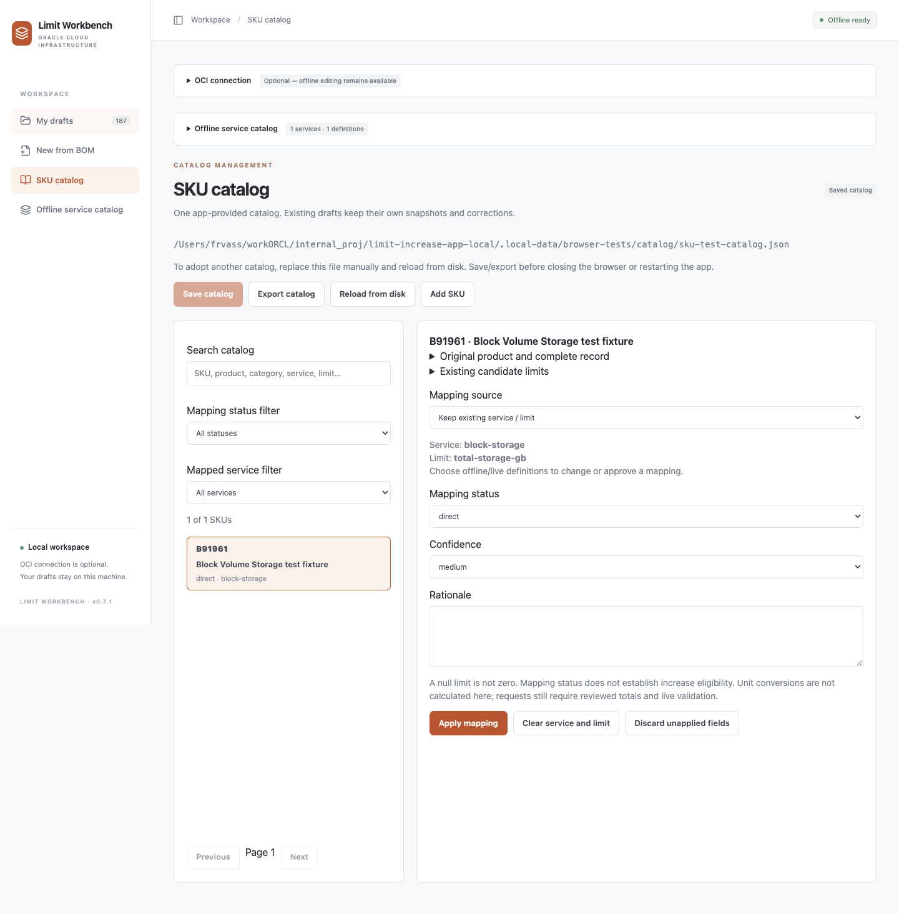

*Figure 13. The editor separates applying a mapping to its working copy from saving the catalog on disk.*

1. Open **SKU catalog** and verify the displayed catalog path.
2. Search by SKU/product/category/service/limit, or filter by mapping status and service.
3. Select a SKU and inspect its product information and candidate limits.
4. Choose a mapping source:
   - **Keep existing service / limit** for rationale/confidence edits or marking an existing mapping for review.
   - **Offline service catalog** to select from the installed definition pair.
   - **Live OCI definitions (connected)** to explicitly use the current connection.
5. Select the service/limit where applicable, review status and confidence, and enter a rationale. Changing service clears the selected limit.
6. Click **Apply mapping**. This changes the editor's working copy only.
7. Click **Save catalog** and confirm to persist the applied changes. The prior file is backed up in **.catalog-backups/** under the application folder.
8. Use **Export catalog** to download the applied working copy for sharing.

Apply or discard pending form fields before saving/exporting. **Clear service and limit** clears the form's mapping fields; Apply is still required.

To add a product, click **Add SKU**, enter the exact new identifier and product name, optionally fill the category/unit fields, and click **Add SKU to working copy**. The new mapping begins unresolved; review/apply it and save the catalog. Duplicate identifiers are rejected.

Applied edits survive navigation within the tab, but save/export before refreshing/closing the browser or restarting the server. **Reload from disk** discards unsaved working-copy changes after confirmation. If another tab or an external replacement changed the file, Save refuses to overwrite it: export your applied edits, reload, and reconcile them.

The app uses the single **oci_sku_limit_catalog.json** in the app folder. There is no catalog selector, per-BOM catalog upload, or Save As. To adopt another catalog, back up the existing file, replace it manually using that filename, and reload from disk.

**New BOM drafts use the saved catalog. Existing drafts retain their snapshots and draft-only corrections; catalog changes do not silently remap them.** Mapping labels such as direct or unit_conversion do not establish increase eligibility or perform quantity conversion.

### Initialize or replace offline service definitions

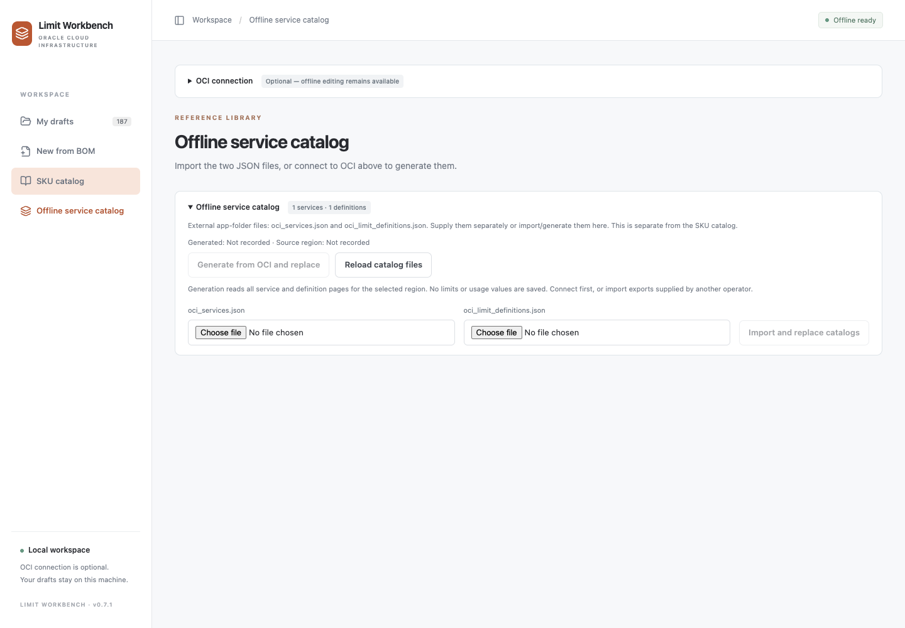

*Figure 14. Offline service definitions are a separate reference library from the SKU mapping catalog.*

1. Open **Offline service catalog** in the sidebar.
2. Choose one of the following methods:
   - Select both **oci_services.json** and **oci_limit_definitions.json** supplied as CLI-compatible exports, then click **Import and replace catalogs**.
   - Connect to OCI, select the intended region, and click **Generate from OCI and replace**.
3. Review and confirm the destination replacement.
4. Check the resulting service/definition counts and available generation metadata.

Generation reads all service/definition pages before replacement. The files contain reference definitions, not current limits, usage, credentials, or a draft's target tenancy. Previous files are backed up. Replacing the pair does not rewrite the SKU catalog or remap existing drafts.

Both absent files mean the offline library is uninitialized. A partial, invalid, unreadable, or generation-mismatched pair needs correction. Restore both files from the same backup generation when recovering a mismatched pair.

## 12. Troubleshooting, storage, and limitations

### Common problems

| Symptom | Action |
| --- | --- |
| Python not found or dependency setup fails | Use an approved compatible Python installation with pip/venv. Resolve proxy/certificate/package-mirror access, then rerun setup. |
| PowerShell scripts are blocked | Use the Command Prompt launchers or another IT-approved entry point. The direct setup entry point is py -3 scripts\setup_app.py; startup is .venv\Scripts\python.exe scripts\run_app.py. |
| Setup incomplete, relocated environment, or changed dependencies | Stop the app, rename the incompatible .venv aside, and run setup in the current application folder. Preserve catalogs and user data. |
| Port already in use | Stop the other instance, or start with --port 8767 and open that port. |
| Prebuilt UI missing | Re-extract the complete release. Operators should not need to build the UI. |
| SKU catalog missing | Copy oci_sku_limit_catalog.json into the app folder and refresh. Existing draft import remains available. |
| Missing BOM columns or unsupported workbook layout | Use the template headers and a BOM data sheet with headers in row 1, or export UTF-8 CSV. |
| Blank or unexpected requested total | Review the SKU mapping and selected limit's unit. Totals/conversions are not generally inferred from the BOM. |
| No offline service/limit choices | Initialize both offline catalog files through Offline service catalog. |
| OCI connection fails | Verify the local config path, API-key profile, permissions, and connectivity. Offline editing/saving remains available. |
| Usage/current value is unavailable | Read the item warning. Unknown or denied data is not zero; request validation may remain blocked. |
| Download CLI bundle is disabled | Prepare and validate against the current target; resolve blockers and renew expired or invalidated validation. |
| Submit to OCI… is disabled | Check successful current validation, a saved current draft, the profile-region match, and duplicate/uncertain attempt warnings. |
| Request changed — validate again | Review the edits or target change, prepare again when required, then validate. |
| Browser response was lost during submission | Reload local submission records first. Inspect the recorded outcome before retrying or using any other submission route. |
| Save conflict or catalog changed externally | Preserve/export current edits, then use the draft conflict controls or reload/reconcile the catalog as appropriate. |
| Status refresh fails | Verify the connected tenancy and read permission. Treat the displayed status as potentially stale. |

### Storage and backups

| Data | Default location / behavior |
| --- | --- |
| Drafts on macOS/Linux | ~/.local/share/oci-limit-workbench/ |
| Drafts on Windows | %LOCALAPPDATA%\OCILimitWorkbench\ |
| Submission journal | submissions/ inside the configured draft directory. |
| SKU catalog and default offline pair | Application folder beside the launch scripts. |
| Catalog backups | .catalog-backups/ under the relevant catalog directory. |
| Browser downloads | Your browser's configured download destination. |

**--data-dir** or **LIMIT_APP_DATA_DIR** selects draft/journal storage. **--offline-catalog-dir** or **LIMIT_APP_OFFLINE_CATALOG_DIR** can select a directory containing the offline service/definition pair. These settings do not select another SKU catalog. The draft workspace's displayed filename/path identifies the local saved file or intended destination.

Back up drafts **together with submissions/**, plus the operational catalogs and catalog backups. A portable JSON export is useful for handover, but preserve the authoritative local journal as well.

To upgrade, stop the old app, extract the new release into a new folder, run setup there, copy your catalogs, and reuse the existing draft data directory. Do not copy .venv between folders or machines, and do not overwrite user data with a release archive. Run only one app process per catalog directory.

### Current limits of the workflow

- Technical validation and a submitted/accepted request do not guarantee OCI approval or an immediate limit change.
- No automatic unit conversion, duplicate-row aggregation, or background status polling is provided.
- Ordinary current readings must be refreshed after a browser/server session change; saved validation is historical evidence until renewed.
- Direct submission requires the profile region. Validated CLI export can use the selected live-data region.
- CLI-created request attachment, reconciliation of unknown attempts without an OCID, and region-comparison draft creation are not available.
- Offline snapshots can become outdated. Use current OCI preparation/validation before executing a request.

### Guide verification

This guide was checked against the local v0.7.1 application source, installation instructions, and running browser UI. Screenshots were taken from the isolated fixture server, which blocks outbound connections and supplies synthetic OCI/profile data. The walkthrough exercised BOM import, draft edits, catalog screens, synthetic connection and mapping, live-value display, questionnaires, validation, local saving, simulated submission, and simulated status refresh. It does not establish real-tenancy acceptance or native workflow compatibility on other operating systems.

Keep **USER_GUIDE.md** and the **images/** folder together when moving or sharing this guide; image links are relative.
